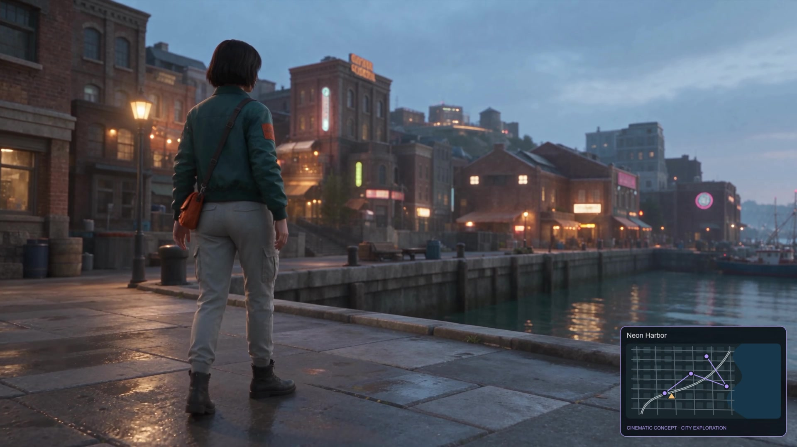

# Kivo City Cinematics

[English](#what-it-makes) · [中文](#中文使用说明)

An Agent skill for original open-world city cinematics: city + places + character → concept map → reference images → comparable Drafts → selected HD final → edited MP4. Powered by [Kivo Studio](https://kivst.com) MCP, with local editable graphics and assembly scripts.

## What it makes

- **Character intro:** a compact 12-second cut with a map, city still, 5-second generated character shot and endcard.
- **City trailer:** a 15-second cut with a separately generated city flyover and character shot.
- Original SVG/PNG city map, minimap HUD and title card; editable brief, prompt plan and assembly manifest.
- Named video prompts and generation results in Kivo, available for further human selection and editing on the website.

Maps are fictional concepts, not navigation. This is cinematic video generation, not a playable game. The skill uses original assets; it is not affiliated with Rockstar Games or Grand Theft Auto. Local composition and 1080p export do not upgrade the native quality of a low-resolution source clip.

## Preview and validation

[](examples/demo/neon-harbor-preview.mp4)

[Watch the 12-second preview](examples/demo/neon-harbor-preview.mp4) · [Concept map](examples/neon-harbor-map.png) · [Validation and actual cost](VALIDATION.md)

Live reference-image → two Drafts → selected native 1080p final → edited-cut validation passed, using **460 credits**. The distribution preview is 720p and silent; the full cut was exported at 1920×1080. Five seconds are generated animation; the remaining seven seconds are map, city still and endcard. Six automated local tests also passed.

## Install with an Agent

Give your Agent this repository URL and ask:

> Install the `kivo-city-cinematics` skill from this repository. Connect the Kivo Studio remote MCP server at `https://kivst.com/mcp`, open its browser login/consent flow, and verify the connected account. Install the local Node dependencies and check FFmpeg before generating anything. Show me a live credit quote before paid generation.

Copy the **entire** `kivo-city-cinematics/` folder into your client's skill directory; do not copy only SKILL.md. For Codex the usual user directory is `~/.codex/skills/`; for Claude Code use its supported skills directory. Other Agents need support for skill instructions, shell scripts, remote HTTP MCP and OAuth. Not every Agent can install a skill or open OAuth from a pasted URL automatically.

Kivo MCP endpoint:

```text
https://kivst.com/mcp
```

For clients that use `mcpServers` and HTTP transport (check the client's exact schema):

```json
{"mcpServers":{"kivo":{"type":"http","url":"https://kivst.com/mcp"}}}
```

Authorize read, write and generation access using your Kivo login. No API secret or password belongs in this JSON. Use the client's reconnect flow if a generation call reports insufficient scope. Project creators pay for generation in shared projects.

For Codex CLI, if automatic client registration opens an `invalid_redirect_uri` page, retry with dynamic client registration and explicit scopes:

```bash
codex mcp login kivo --oauth-client-registration dcr --scopes 'kivo:read,kivo:write,kivo:generate,kivo:billing,offline_access'
```

Close the old authorization tab and complete the new one. If an already-running client still uses its previous grant, reconnect/reload that MCP connection; do not repeatedly submit generation jobs or weaken server authorization.

## Local setup

Node.js ≥22.12, npm, FFmpeg and FFprobe with libx264 are needed. On macOS FFmpeg can be installed with `brew install ffmpeg`; on Debian/Ubuntu use the OS package manager. If executables are elsewhere, set `FFMPEG_BIN` and `FFPROBE_BIN` to their paths.

Chinese graphic labels need an installed CJK font such as PingFang SC or Noto Sans CJK. On a minimal Linux host install the appropriate fonts and inspect a rendered PNG for missing glyphs before generation.

```bash
cd kivo-city-cinematics
npm ci
npm run doctor
npm test
node scripts/plan.mjs --brief examples/neon-harbor.json --out work/neon-harbor
node scripts/render-map.mjs --brief examples/neon-harbor.json --out work/neon-harbor
```

Copy the example brief and customise it first. `plan.mjs` and `render-map.mjs` never call paid APIs. Follow SKILL.md for generation, download the selected media into the work directory, then:

```bash
node scripts/assemble.mjs --manifest work/neon-harbor/assembly.json --out work/neon-harbor/cinematic.mp4
```

The local edit is silent by default. Supply a local `audio` file in the assembly manifest for sound; source clip sound is not automatically retained. Defaults are choices, not a restriction on the Agent's creative plan. Prices, models and limits are read from the live catalog and quotes.

## 中文使用说明

把仓库链接发给支持 Skill 的 Agent，请它安装整个 `kivo-city-cinematics` 目录，再连接 `https://kivst.com/mcp`，完成网站登录和授权。给出城市、1–6 个地点、原创角色、画幅和积分预算即可。生成前会查询实时报价，得到确认后才提交任务。

示例：

> 使用 kivo-city-cinematics。做一条 16:9 的原创开放世界城市角色出场片，城市叫 Neon Harbor，地点包括旧码头、灯笼市场、天际桥和观景山。角色叫 Mira，深青色飞行夹克、灰色工装裤和橙色挎包。先出地图和参考图，再做两条样片，挑一条生成 1080p。最多使用 500 积分；如果超预算先告诉我。画面和标题用英文。

本地地图是虚构概念地图，不是 GTA 地图复刻，也不是城市导航。紧凑模板成片 12 秒，其中动态角色镜头 5 秒，其余为地图、城市静帧和片尾；需要更丰富的动态镜头可选城市预告片模式并重新报价。生成的项目、提示词和视频可以回到 Kivo 网站查看、选片和继续制作。

暂不自动发布到社交平台。没有后台部署步骤，不修改 Kivo 网站代码。
